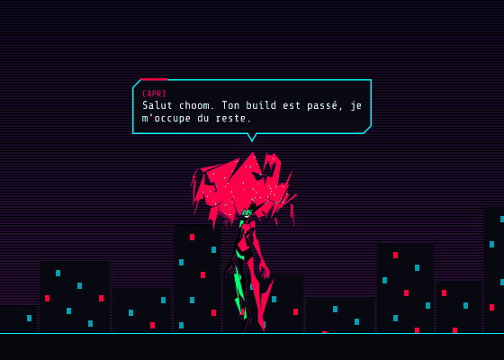

<h1 align="center">capri-rs</h1>

<p align="center">
  
</p>

<p align="center">
  A netrunner who lives on your desktop. She sits on your windows, falls when you close them,<br>
  naps when you ignore her, and talks back through whatever model you point her at.
</p>

---

capri-rs is a Rust rewrite of [capri-ai-desktop](https://github.com/edgerunners-2/capri-ai-desktop).
Same character, same sprite sheets, new engine: one native binary, a ports-and-adapters core you can
test without a screen, and a brain that can be a local llama.cpp, Ollama, LM Studio, a cloud API, or
Claude Code.

Capri is drawn by **xilia_world00** and is a fan take on Capricorn from *Cyberpunk: Edgerunners*.
More on that in [Credits](#credits).

## Run her

You need Rust (stable) and something that speaks the OpenAI chat API. A llama.cpp server is enough:

```sh
llama-server -m your-model.gguf --port 8080
```

Then:

```sh
git clone https://github.com/Rhombicdodecahedron/capri-rs
cd capri-rs
cargo run --release
```

She drops in from the top of the screen and lands on the first window edge she meets. Right-click her
to open the settings and point her at your server.

Windows is the main target (real per-pixel transparency, clicks go through the empty parts of her
window). Linux and macOS run, with her standing on the bottom of the screen until those platforms get
their own window-edge adapter.

## Talk to her



Click her and type. Enter sends, Esc closes. The reply streams in while her mouth moves.

She answers in the language you write in. The labels around her follow the interface language
(French or English, or whatever your system uses).

A few things work without a round trip to the model:

- `souviens-toi que ...` / `remember that ...` saves a fact about you
- `oublie ...` / `forget ...` drops it
- `/new` starts a fresh chat
- `/settings` opens the settings, `/quit` sends her home

Music commands also skip the model: `pause`, `suivante`, `monte le son`, `mets Daft Punk sur Spotify`,
`mets en aléatoire`, `like cette chanson`, `c'est quoi cette musique ?` (and their English versions).

So do a few things for her body: `va faire une sieste`, `passe en mini`, `reviens`, `allonge-toi`,
`réveille-toi` (or `take a nap`, `go mini`, `come back`, `lie down`, `wake up`).

Drag her to move her, let go fast to throw her. Double-click to poke her awake.

## Her rest

Left alone, she doesn't just hop around. Now and then she lies down on the taskbar or on top of the
window she sits on, breathing slowly; after a while her eyes drift shut and z's float up, and she
gets up again on her own (never in the middle of a sentence). If you talk to her while she lies
there, she answers lying down. Nobody around for a couple of minutes and she lies down more often,
for longer.

Sometimes she takes a proper nap: she shrinks into her mini form, a little screen with her eyes, on
the taskbar or on her window, eyes shut, z's drifting up. She mumbles back if you talk to her, and
after a minute or two she wakes up full size. After five minutes without a sound she dozes off
standing up too.

Asked to go mini, she stays small and awake until you bring her back: she blinks, her eyes follow your
pointer, she talks with her little mouth, and three quick clicks get you a fed-up look. A
double-click brings her back full size, from a nap or from lying down too. All of this can be
switched off in the settings, under BEHAVIOUR.

Facts and the chat log stay on your machine, in a SQLite file in your profile folder.

<br clear="right">

## Her powers

When the brain supports tool calling (llama.cpp with `--jinja`, Ollama, LM Studio, OpenAI, OpenRouter),
she acts on your PC instead of describing what you could do:

- **Spotify, by its buttons.** No Web API and no account keys: she finds Play, Next, Shuffle, Like and
  the search results in Spotify's own window and presses them, like Playwright on a web page.
  "Mets Get Lucky" opens the search and clicks the matching result. "What's playing" reads the window
  title. When a button can't be found she uses Spotify's keyboard shortcut instead, and when Spotify
  isn't open, play, pause and next go to any player through the media keys.
- **Any other app, the same way.** `ui_windows` lists what is open, `ui_snapshot` reads a window's
  controls (each with a ref, like Playwright's accessibility snapshot), then `ui_click`, `ui_fill` and
  `ui_press` act on them. Buttons are pressed through Windows accessibility, so most of the time the
  mouse doesn't move and the window doesn't even need to be in front.
- **The rest of the original's toolkit:** open an app by name (`ouvre la calculatrice`, `lance Steam`),
  open a website, search Google, YouTube, Wikipedia or Maps, tell the time, lock the PC, remember a
  fact about you.

Every action goes through one approval check. With **Ask first** she asks in the chat box
("Je peux ? Spotify: play "Get Lucky" (oui / non)") and your next line, typed or said, is the answer;
anything else counts as no. Music commands you type yourself run directly. Whatever the setting,
she always asks before a button that deletes, sends, pays or signs out, before Enter in anything that
isn't a search box, and before shortcuts like Alt+F4. Password managers, banking, private browsing,
sign-in windows and anything on your own never-touch list are off limits: she doesn't read them or
touch them.

Driving apps works on Windows. On Linux and macOS she has the other powers and the media keys.

## Settings


Right-click her, or type `/settings`. Everything she reads from `capri.toml` is in there: the brain
(engine, URL, key, model, temperature), her body (skin, size, how often she hops around, when she
dozes off), her persona prompt, what she is allowed to do on your PC, and the language.

**Test** lists the models on the server and times a short reply before you save anything. Saving
applies at once, no restart: she swaps brains mid-conversation and reloads her sprites if you changed
the skin or the size.

For llama.cpp, leave the model empty to use the first one the server lists, or pick from the names TEST shows (servers hosting several models only accept those exact names). Reasoning
models (Qwen3 and friends) have their thinking switched off by default, so the first word comes fast;
there is a checkbox if you want it back.

The file is plain TOML if you prefer editing it by hand. `cargo run -- paths` tells you where it is,
and comments you write in it survive saves from the panel.

## Other commands

```sh
cargo run -- chat               # same brain and memory, in the terminal
cargo run -- brain              # test the configured brain from the command line
cargo run -- skins              # list installed skins
cargo run -- preview capri      # render a skin's poses to preview.png
```

## How it is put together

```text
apps/capri                     reads capri.toml, builds the adapters, starts the desk
│
├── adapters/                  everything that touches the outside world
│   ├── desk-winit             her window: winit + tiny-skia, layered window on Windows
│   ├── settings-egui          the settings panel
│   ├── llm-openai             llama.cpp, Ollama, LM Studio, OpenAI, OpenRouter, anything /v1
│   ├── llm-claude-code        the Claude Code CLI
│   ├── desktop-windows        visible window edges via Win32
│   ├── ui-windows             her hands on other apps: Windows UI Automation
│   ├── system-os              open apps and sites, web search, time, lock
│   ├── media-os               media keys and system volume
│   ├── memory-sqlite          facts and chat log
│   └── skin-fs                sprite sheets from assets/skins
│
├── crates/capri-config        the capri.toml schema, comment-preserving save
├── crates/capri-application   use cases (chat, desk, tools, Spotify, app driving) and their ports
└── crates/capri-domain        pure logic: falling, perching, roaming, approvals, locators, risky labels
```

Dependencies point inward only. The domain has no I/O at all: time comes in as a number, the desktop
comes in as a list of ledges, randomness comes from a seeded generator. That is why falling off a
closed window or dozing off after five idle minutes are plain unit tests.

Anything she does on your PC goes through one approval check in the application layer. Text from
the model can ask for an action, never approve one. Which button is risky and which window is private
is decided in the domain, so no adapter can skip it.

## Skins

A skin is a folder of PNG strips in `assets/skins/<name>/`, in the same format as the original project,
so its skins drop in unchanged. See [assets/skins/README.md](assets/skins/README.md). A placeholder
`demo` skin is included for testing.

## Where it is going

- [x] On the desk: perching, falling, roaming, sleeping, lying down, mini naps, chat, memory
- [x] Brains: llama.cpp, Ollama, LM Studio, OpenAI, OpenRouter, Claude Code
- [x] Settings panel with live reload, French and English
- [x] Tools (music, apps, web, driving other apps) behind the approval check
- [x] Voice in and out
- [ ] Reminders, timers and to-do lists
- [ ] Files (notes, cleaning Downloads) and reading web pages
- [ ] MCP client
- [ ] Driving apps on Linux (AT-SPI) and macOS
- [ ] Window edges on macOS and Linux

## Credits

- **Art:** Capri by xilia_world00 (Discord), used with permission. The art is
  **not** under this repository's MIT license; ask her before reusing it.
- **Original project:** [capri-ai-desktop](https://github.com/edgerunners-2/capri-ai-desktop) by
  yume_mud (MIT), where the idea and the sprite format come from.
- **Font:** Share Tech Mono, SIL Open Font License.
- Capri is a fan character based on Capricorn from *Cyberpunk: Edgerunners*. Cyberpunk is a trademark of
  CD PROJEKT RED. This is an unofficial fan project, not affiliated with or endorsed by CD PROJEKT RED,
  Studio Trigger or Netflix.

Code under the MIT license, see [LICENSE](LICENSE) and [NOTICE.md](NOTICE.md).
